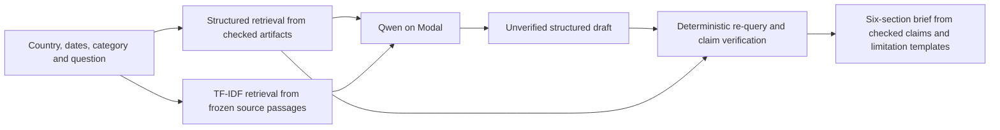

# MeaslesWatch BD

**Sole project contributor:** [ahmedshahid2929@gmail.com](mailto:ahmedshahid2929@gmail.com)

A reproducible retrospective measles surveillance study and evidence-grounded LLM
evaluation, using public Bangladesh surveillance/coverage extracts. Six Streamlit
pages connect audited data, historical statistical models, scientific briefs and
an independent 30-question external benchmark.

**Research prototype:** reported all-age counts are not infection incidence. Flags
are statistical exceedances, not independently confirmed outbreaks. This system
does not provide clinical decisions, causal vaccine-effect estimates, a live warning
service or validated prospective outbreak prediction.

## Run the dashboard

Verified with Python 3.13. Install [uv](https://docs.astral.sh/uv/) and run from the
repository root:

```sh
uv sync --locked --python 3.13
uv run --locked python scripts/prepare_checkout.py
uv run --locked python scripts/fetch_sources.py
uv run --locked pytest -q
uv run --locked streamlit run app.py
```

Saved data, figures, case outputs and briefs work offline. Navigation and filters
do not invoke an LLM or consume Modal credit. The installed Python dependencies
and the initial model download require network access; the dashboard itself does
not fetch new observations.

## Reproduce the science

Each output directory must be new. Existing scientific outputs are not overwritten.

```sh
uv run --locked measleswatch reproduce --output results/my-reproduction
uv run --locked measleswatch score --run results/research-001 --output results/my-scores
uv run --locked measleswatch score --run results/research-001-primary --output results/my-original-attempt-scores
uv run --locked python scripts/build_report.py --output reports/my-report.md
```

The first command rebuilds canonical tables, descriptions, models, diagnostics,
sensitivities and six original figures from frozen inputs. It performs no inference.
The second re-scores saved responses offline using the frozen private gold. The
third writes the scientific report from actual saved analysis and scored results.
Scoring/report generation requires the completed saved experiment, not live API access.

The reference reproduction is [reproduction-001](results/reproduction-001/reproduction_manifest.json).
All four canonical tables, eight descriptions and eight statistical artifact hashes
match their reference runs exactly in the verified environment. Timestamped run
manifests and rendered-image metadata are not expected to have identical bytes.
Other operating systems/BLAS libraries may introduce floating-point differences;
the checked-in JSON artifacts remain the recorded results.

Some initial run manifests retain earlier implementation hashes from before wrapper
parameterization. The current locked code reproduces their numerical artifact hashes;
new reproduction manifests record the current implementation. Historical provenance
files are retained rather than rewritten to claim an identical original source version.

## What the analyst does

There is **no training or fine-tuning**. The analyst uses a pinned, pretrained
Qwen3-4B on a private Modal L40S container. It combines real retrieval with bounded
statistical computations:



Structured retrieval supplies reporting totals, completeness, expected counts,
thresholds and cutoffs. Lexical document retrieval supplies WHO context, with line
locators and hashes. The model cannot execute code, browse or access gold answers.
The checker independently retrieves calculated evidence and validates value, unit,
case definition, geography, age scope, dates and locators. It can correct an emitted
claim from source evidence, reject an unknown claim, or preserve ambiguity. It does
not turn a failed/empty generation into a perfect answer. Unchecked narrative remains
a draft; verified prose is rendered from checked claims and approved templates.

Grounding and verification reuse the same public-source adapters. Re-querying avoids
trusting the model's echoed values, but shared parsing/scope bugs can survive B and C.
The separate frozen gold/oracle tests that boundary; it is not a runtime evidence source.

This is a small **hybrid RAG system with deterministic verification**. No vector
database, embedding service or paid per-token API is required. Verification is bounded
to the registered source schemas; it is not a universal medical fact checker.

## Statistical design

- Frozen August 2026 data; January 2012–July 2026 observations. All 2026 counts are
  provisional; June–July are descriptive, lag-sensitive extensions.
- Primary outcome: all-age laboratory-confirmed measles. Total classified cases
  form a separate sensitivity outcome; suspected cases are never added to that total.
- Development: rolling 2017–2021. Test: rolling 2022–2025. Case study: January–May
  2026, with one fixed fit through December 2025. Every training cutoff precedes
  the scored month. Historical release vintages are unavailable, so this is
  observation-time separation, not a reconstruction of information available live.
- Seasonal-naive point comparator; month-specific historical seasonal reference;
  NB2 count regression with time and annual sine/cosine over 60 months.
- Predictive bounds, dispersion/convergence/residual diagnostics, paired block
  bootstrap, 36/84-month windows, definition sensitivity, isolated missingness and
  outlier stresses. Failed fits are retained. Plug-in bounds omit some uncertainty.
- Forty synthetic paths provide known-label stress tests. Their alert metrics do
  not validate Bangladesh public-health effectiveness.

The original synthetic monthly summary conditions on available model fits. This
differs from the all-eligible denominator in the protocol. The separate
`results/synthetic-failure-audit-001` retains every eligible month and bounds rates
when predictions are unavailable; event recall already counts failed fits as misses.
Both summaries are retained and labeled, rather than silently deleting failures.

Annual administrative, official and WUENIC coverage remain separate. Values above
100% and source disagreement are retained. No sampling variances are available for
coverage confidence intervals. Age-specific WHO document statements remain separate
from all-age monthly tables, including the source's unresolved contradictions.

## Independent LLM experiment

`external-v1` contains 30 test questions and six development questions from frozen
CDC, ECDC and UKHSA publications. It excludes the Bangladesh Zenodo package and WHO
DON598. Questions/gold were frozen before model outputs; the private oracle and
production evidence adapter are separate implementations. There is no claim of
external blinded human adjudication or facts unknown to the pretrained model.

| Condition | Inputs and processing |
| --- | --- |
| A: direct | Public question/schema and full registered original source text; no calculated fact bundle |
| B: grounded | Exactly the same source coverage plus deterministic calculated facts and scope metadata |
| C: verified | The exact B draft checked against independently re-queried public evidence; no new generation |

The approved completion amendment runs one paired seed (2026), yielding 60 test
generations and 90 A/B/C test outputs. Repeated-seed experiments are optional future
work. This experiment isolates evidence computation and verification under equal
source coverage; lexical passage retrieval is evaluated separately. A is not a
no-evidence baseline, and this experiment does not establish the benefit of retrieval
over a closed-book model.

Strict item credit requires correct status, every slot, units, scope, citations and
limitations. Numerical accuracy is reported separately. First-pass and post-schema
repair scores retain all failures. One syntax-only repair is allowed; incomplete
thinking/truncation does not receive a new factual answer. Paired uncertainty resamples
whole questions; 30 selected questions do not support a general model ranking.
Questions share four documents, so item-bootstrap intervals do not capture
between-publication generalization uncertainty.
Citation scoring checks registered passage overlap, not unlimited semantic truth.
See [development amendment](planning/DEVELOPMENT_AMENDMENT.md) for retained earlier
development prompts and the prospective pre-test scope correction.

The original attempt suffered a Modal client disconnection after five paired test
questions. Its failure-inclusive 30-item scores remain in `benchmark-primary-score-001`.
The secondary recovered-completion run continues only jobs with no returned response;
every earlier draft, question, prompt and seed remains intact. This is an explicit
deviation from the original infrastructure-failure rule, documented in
[infrastructure recovery](planning/INFRASTRUCTURE_RECOVERY.md). Both analyses must be
reported; the recovered result does not establish production reliability.

## Explicit Modal generation

The existing study uses profile `kazigalib143`, one scale-to-zero L40S container,
Qwen3-4B revision `1cfa9a7208912126459214e8b04321603b3df60c`, thinking enabled,
131,072 configured context tokens and 32,768 maximum generated tokens. Capacity was
separately tested on a representative 20,816-token input. The full configured maximum
is a bound, not a measured capacity guarantee. Model settings and GPU package pins
are in [.devin/study.toml](.devin/study.toml) and [modal_app.py](modal_app.py).

Authenticate Modal privately using its CLI; never put credentials into Git or this
README. Configure the intended workspace/profile in a **new recorded study version**
before a new experiment. A fresh checkout needs a local ledger copied from
`.devin/modal_ledger.example.json`; set its workspace to your intended profile and
record confirmed workspace spending controls only after actually checking them.
The recorded reference experiment retains its own local ledger and all earlier
pilot reservations. Do not reset that ledger or reuse reference run IDs.

Use **Generate Research Brief** for an explicit selected request, or:

```sh
uv run --locked measleswatch infer --output results/my-new-modal-run
```

The batch runner checks active apps, reserves worst-case repairs, checkpoints every
case, enforces cumulative time/generation/monetary estimates, and stops its private
app. The $30 project authorization is a ceiling; the working reservation limit is
$20. Estimates/reservations are not provider billing caps, and workspace metered
deltas may lag or include unrelated activity. The model cache can remain after the
app stops; its storage billing is separate from active GPU time.

## Repository map and deliverables

| Location | Role |
| --- | --- |
| `app.py` | Six artifact-driven Streamlit pages and exports |
| `src/measleswatch/` | Ingestion, audit, modeling, retrieval, verification, inference and offline scoring |
| `planning/source_snapshots/` | Immutable source extracts and download/hash manifests |
| `data/processed/phase1-r2/` | Canonical Bangladesh tables, dictionary and validation |
| `results/description-001/`, `audit-001/`, `statistics-001/` | Source-linked analytical results |
| `results/figures-001/` | Six PNG/SVG figures with plotted CSV and metadata |
| `results/research-001/` | Exact requests, raw/final outputs, verified briefs and attempt history |
| `results/benchmark-score-001/` | Recomputed scorecards, case verdicts and reviewed examples |
| `results/research-001-primary/`, `benchmark-primary-score-001/` | Original disconnected attempt and failure-inclusive scores; recovered completion is a separately labeled secondary analysis |
| `benchmark/frozen/external-v1/` | Frozen public questions/evidence/protocol |
| `benchmark/private/external-v1/` | Scorer-only gold/oracle; never runtime model inputs |
| `reports/research_report.md` | Scientific report generated from measured artifacts |
| `planning/COMPLETION.md` | Final specification checklist and verification evidence |

Original code: MIT. Dataset extracts and publisher text retain their own terms; see
[source attribution](DATA_SOURCES.md). The initial GitHub repository is private;
changing visibility needs a deliberate source-rights and benchmark-release decision.
