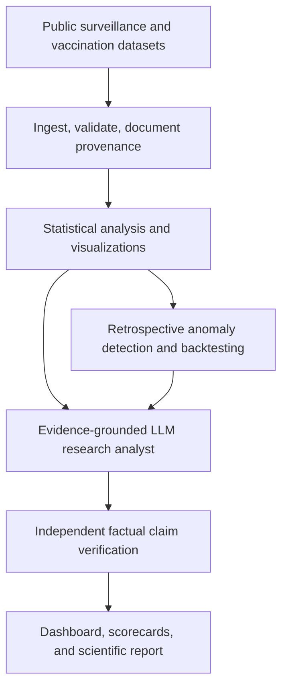

# MeaslesWatch BD

**An AI-Assisted Infectious Disease Surveillance and Scientific Evaluation System**

**Document type:** Project feature specification and two-day implementation plan  
**Project status:** Proposed research prototype  
**Primary focus:** Statistical analysis, outbreak anomaly detection, reproducible research, and trustworthy LLM-generated scientific reports  
**Intended audiences:** Scientific-research hiring portfolio and Torena Labs AI/data evaluation portfolio

> **Research-use disclaimer:** MeaslesWatch BD is a retrospective, exploratory research prototype. It is **not** a medical diagnostic tool, real-time outbreak warning service, clinical decision-support product, or validated public-health forecasting system.

---

## 1. Project overview

MeaslesWatch BD analyzes historical measles surveillance and vaccination data for Bangladesh to answer four questions:

1. **What happened?** How have reported measles cases varied over time?
2. **What looks unusual?** Which historical observations differ from expected seasonal patterns?
3. **How reliable are the methods?** Do more sophisticated statistical models outperform simple baselines under time-respecting evaluation?
4. **Can an LLM report the findings accurately?** Can its numerical and evidence-based claims be independently checked?

The product should be a small, reproducible research platform, **not merely a dashboard**. Its distinctive contribution is evaluating the reliability of both statistical anomaly detection and AI-written scientific explanations.

### Overall workflow



---

## 2. Data sources and research constraints

### Planned inputs

- **Historical monthly measles surveillance data** for Bangladesh and neighboring countries, including case categories when the dataset provides them.
- **Annual WHO/UNICEF measles vaccination coverage** for contextual trend analysis.
- **WHO outbreak reports** for narrative background and corroborated, age-specific findings.

**Starting sources:**

- [Public research dataset deposit (Zenodo)](https://zenodo.org/records/22167512)
- [WHO Immunization Data: Bangladesh](https://immunizationdata.who.int/dashboard/regions/south-east-asia-region/BGD)
- [WHO outbreak report (April 2026)](https://www.who.int/emergencies/disease-outbreak-news/item/2026-DON598)

Before analysis, **verify access, coverage dates, field definitions, licensing, and provenance**. If an expected file is missing or differs from its description, adjust the project documentation rather than inventing or silently substituting observations.

### Non-negotiable scientific safeguards

- The monthly surveillance series is **all-age data** unless the file explicitly provides child-age fields. Do not represent it as pediatric-only.
- Keep **suspected, clinically confirmed, epidemiologically linked, and laboratory-confirmed** counts separate unless a documented case-definition rule permits aggregation.
- Missing reports, zero reported cases, and true zero infections are **not necessarily equivalent**.
- Surveillance data can include reporting delays, revisions, and under-ascertainment.
- Vaccination coverage associations **do not establish causality**.
- Retrospective anomaly flags are **not confirmed outbreaks**.
- Keep a source log and cite dataset versions and retrieval dates.

---

## 3. Application structure

A simple **Streamlit** web application should expose the following six research pages:

1. **Surveillance Overview**
2. **Data Quality Audit**
3. **Statistical Analysis**
4. **Anomaly Detection**
5. **LLM Research Analyst**
6. **LLM Evaluation**

Each page should work with reproducible outputs generated by Python scripts. Important figures and tables should be downloadable as CSV or images, with research metadata attached where practical.

---

## 4. Feature 1: Surveillance Overview

**Priority:** Essential

**Purpose:** Make historical disease-surveillance patterns explorable without obscuring source definitions.

### Required capabilities

- Select country, year or date range, and case category (based on available fields).
- View total *reported* cases for the selected period, reporting-month coverage, and most recent available observation.
- View an interactive monthly case-count time series.
- Compare years or periods and show year-over-year changes when comparable.
- View historical vaccination coverage as a **separate chart**, not on a misleading common scale.
- Clearly label source, units, date range, and provisional/revised status if available.
- Download filtered data and charts.

### Suggested layout

- Filters across the top.
- Small metric cards for observations, reported cases, and flagged months.
- Main time-series plot.
- Secondary coverage and comparison plots.
- Expandable **Data limitations** panel.

### Acceptance criteria

- Changing filters updates statistics and visualizations consistently.
- Users can tell case categories and source date ranges apart.
- No fabricated numbers appear in charts, demo summaries, or README screenshots.

---

## 5. Feature 2: Data Quality Audit

**Priority:** Essential

**Purpose:** Demonstrate reproducible scientific-data cleaning and validation.

### Required checks

- Dataset schema and expected column types.
- Null or missing values per field.
- Duplicate country–month–case-category records.
- Unexpected negative counts and impossible dates.
- Missing calendar months and discontinuities.
- Country/name/category normalization issues.
- Implausible observations to **flag for review**, not automatically discard.
- Explicit distinction between unavailable reports and genuine recorded zeros.

### Deliverables

- A machine-readable validation report (JSON/CSV).
- An audit table showing issue type, number of affected rows, and examples.
- A documented transformation log.
- Clean analytical tables while preserving immutable raw input files.

### Acceptance criteria

- Re-running validation on unchanged files produces the same result.
- All transformations are documented.
- The pipeline does **not** silently fill missing case counts with zero.

---

## 6. Feature 3: Statistical Analysis Engine

**Priority:** Essential

**Purpose:** Conduct actual quantitative research rather than describing plots informally.

### Core analyses

**Descriptive statistics**

- Cases by month/year and reporting category.
- Long-term and seasonal trends.
- Changes from historical month-specific baselines.
- Data completeness and variability.

**Statistical modelling**

- Historical seasonal baseline, such as a month-of-year reference.
- Poisson regression for count observations when defensible.
- Negative-binomial regression when overdispersion makes it preferable.
- Model diagnostics and residual checks.

**Uncertainty and sensitivity**

- Appropriate confidence or predictive intervals; label the distinction.
- Compare estimates across different historical training windows.
- Document sensitivity to missingness, outliers, and reporting definitions.

**Vaccination context**

- Visual comparison with historical vaccination-coverage trends.
- Exploratory associations only when comparable data support them.
- Explicit warning that observational correlations cannot establish causal effects.

### Required outputs

- At least four clean and labelled visualizations.
- Reproducible statistical notebook or script.
- A structured `analysis_results.json` (or equivalent), containing calculated values, units, date scope, and references to source tables.
- Short interpretation notes stating findings and limitations.

### Acceptance criteria

- Every number in a generated report can be traced to program output.
- Model assumptions are stated, especially for count distributions.
- Undefined or statistically inappropriate analyses are omitted with an explanation.

---

## 7. Feature 4: Historical Outbreak Anomaly Detection

**Priority:** Essential

**Purpose:** Flag unusual reported case counts and rigorously assess false alarms.

### Required models

1. **Seasonal baseline:** Simple historical month-of-year expected count or threshold.
2. **Statistical count model:** Poisson or negative-binomial regression, selected using diagnostics.

A third ML detector is a **stretch goal**, not a prerequisite. Do not train an LSTM or Transformer simply for the sake of adding deep learning.

### How detection works

For each evaluation month:

1. Train or update the model using only observations available *before* that month.
2. Estimate an expected count and corresponding upper prediction threshold.
3. Compare the observed case count with the threshold.
4. Flag an anomaly when the predefined rule is triggered.
5. Save the expected value, uncertainty band, observed count, and model metadata.

### Model evaluation

- Rolling-origin or expanding-window backtesting.
- Mean absolute error (MAE) for point predictions, if applicable.
- Prediction interval coverage and width.
- Alert frequency / false-alert rate under a **clearly defined reference criterion**.
- Detection delay **only if independently dated outbreak events or a defensible event definition are available**.

### Important limitation

An anomaly threshold is not the same as ground-truth outbreak status. Do **not** report clinical sensitivity/specificity or confirmed-outbreak detection rates without a valid independent reference standard.

### Acceptance criteria

- No temporal leakage or future-observation features.
- A simple baseline and a statistical count model are compared fairly.
- Flagged months are accompanied by interpretable evidence and model limitations.

---

## 8. Feature 5: Evidence-Grounded LLM Research Analyst

**Priority:** Essential

**Purpose:** Generate scientific reports based on actual, machine-produced analysis rather than LLM guesses.

### User interaction

The researcher selects a country/date range or a flagged month, then clicks **Generate Research Brief**.

### LLM inputs

- Verified statistics from `analysis_results.json`.
- Relevant visualizations or plot descriptions.
- Source identifiers and dates.
- Selected WHO passages used as contextual evidence.
- Explicit instructions about uncertainty and non-causal language.

### LLM outputs

A structured research brief containing:

1. **Executive summary**
2. **Key observations and numbers**
3. **Anomaly interpretation**
4. **Evidence references**
5. **Limitations and uncertainty**
6. **Conclusions and suggested further investigation**

### Implementation boundaries

- Use structured JSON inputs and outputs.
- Restrict the model to supplied evidence for factual claims.
- Prefer one LLM call per brief instead of an autonomous multi-agent system.
- Never provide medical advice, diagnosis, or operational outbreak response directives.
- Preserve prompts and model configurations for reproducibility.

### Acceptance criteria

- Reports cite traceable statistical evidence.
- Unsupported causal explanations are identified as such.
- Reports can be regenerated from saved inputs and prompt/model settings (subject to model determinism limits).

---

## 9. Feature 6: LLM Factual Accuracy and Evaluation Benchmark

**Priority:** Essential; primary portfolio differentiator

**Purpose:** Quantify whether an LLM accurately communicates scientific data and whether deterministic checking helps.

### Benchmark design

Create approximately **20–30 evaluation cases** spread across:

- Exact numerical lookup.
- Arithmetic or percentage change.
- Time-series comparison.
- Correct interpretation of anomaly flags.
- Distinguishing case categories.
- Evidence citation.
- Appropriately expressing uncertainty.
- Recognizing unsupported causal inferences.

Generate ground-truth numerical answers **programmatically** from the analytical dataset. Document how any non-numerical rubric judgments are assessed; use a small manual review subset if necessary.

### Experimental conditions

| Condition | Model context | Goal |
|---|---|---|
| **A. Direct LLM** | Question with little or no structured evidence | Characterize unsupported or ungrounded responses |
| **B. Evidence-grounded LLM** | Question plus verified statistics and source material | Test whether grounding improves reliability |
| **C. Grounded + deterministic verification** | Grounded response passed through numerical/rule checks | Test how often detected errors can be prevented or flagged |

### Evaluation measures

- Numeric accuracy against known values, with documented tolerances.
- Supported vs unsupported factual claims.
- Citation correctness when independently verifiable.
- Unwarranted causal claim rate.
- Verification error-detection rate.
- False rejections by the verifier.
- A short set of manually reviewed examples for complex interpretations.

### Verification logic

- Parse structured claims from each generated report.
- Compare numeric claims to trusted `analysis_results.json` fields.
- Check units, category, geographic scope, and dates.
- Flag claims that cannot be verified instead of automatically declaring all of them false.
- Recompute the final scorecard from saved case-level results.

### Acceptance criteria

- At least 20 completed, documented cases.
- Three experimental conditions compared on exactly the same test questions.
- Each result contains prompt, response, expected answer/rubric, and verdict.
- Report measured results only after running the benchmark.

---

## 10. Dashboard output and reporting

### Research dashboard

Expose the six pages above and a concise landing-page summary of the project, data provenance, last processed dataset version, and research-use disclaimer.

### Scientific report

Produce a 2–4 page report (Markdown is sufficient; export PDF if time permits) containing:

- Research objective and dataset details.
- Data quality findings.
- Statistical modelling methodology.
- Historical anomaly evaluation.
- LLM benchmark methodology and scorecard.
- Limitations and reproducibility information.

### Portfolio README

The GitHub README should answer:

- What scientific problem was studied?
- Why were the baselines and models chosen?
- What results were measured?
- What did the model and LLM evaluation reveal?
- What is **not** claimed by the prototype?
- How can another researcher reproduce the study?

---

## 11. Recommended implementation stack

| Purpose | Recommended tools |
|---|---|
| Main language | Python |
| Data manipulation | pandas, NumPy |
| Statistical analysis | SciPy, statsmodels |
| ML and baselines | scikit-learn |
| Visualizations | Plotly, Matplotlib |
| Dashboard | Streamlit |
| LLM research analyst | One accessible LLM API or supported local model |
| Evaluations | Python assertions, JSON schemas, custom deterministic scorer |
| Testing | pytest |
| Reproducibility | requirements/lockfile, fixed seeds, saved configs, Git |

**Do not require** Kubernetes, microservices, a vector database, custom model fine-tuning, or multi-agent orchestration for the initial prototype.

---

## 12. Suggested repository structure

```text
measleswatch-bd/
├── README.md
├── PROJECT_SPEC.md
├── requirements.txt
├── .gitignore
├── config/
│   └── evaluation.yaml
├── data/
│   ├── raw/                  # Source files; preserve originals
│   └── processed/            # Reproducible derived data
├── src/
│   ├── ingest.py
│   ├── validate.py
│   ├── statistics.py
│   ├── anomaly.py
│   ├── llm_analyst.py
│   └── evaluate_llm.py
├── app/
│   └── streamlit_app.py
├── experiments/
│   ├── evaluate_anomalies.py
│   └── evaluate_llm.py
├── tests/
│   ├── test_validation.py
│   ├── test_temporal_split.py
│   └── test_claim_verification.py
├── outputs/
│   ├── figures/
│   ├── metrics/
│   └── briefs/
└── reports/
    └── research_report.md
```

Provide a data-download or setup script when redistributing source data is not appropriate under its license.

---

## 13. Two-day execution plan

### Day 1: Scientific data pipeline and statistical modelling

**Target: ~8 hours**

| Phase | Work | Approximate effort |
|---|---|---|
| 1 | Verify/download datasets, inspect field definitions, document sources | 1 h |
| 2 | Implement validation and clean analytical tables | 1.5 h |
| 3 | Run statistical analysis and produce figures | 2 h |
| 4 | Implement seasonal baseline, count model, and backtesting | 2.5 h |
| 5 | Build basic Streamlit pages and exportable outputs | 1 h |

**Day 1 milestone:** Running analysis pipeline, documented data quality audit, at least two compared historical models, and a basic dashboard.

### Day 2: AI research analyst and independent evaluation

**Target: ~8–9 hours**

| Phase | Work | Approximate effort |
|---|---|---|
| 6 | Generate evidence-grounded research briefs | 1.5 h |
| 7 | Create 20–30 benchmark cases and ground truths | 1.5 h |
| 8 | Run 3 LLM conditions and implement deterministic verification | 2.5 h |
| 9 | Integrate LLM evaluation scorecards into dashboard | 1 h |
| 10 | Test, document, and write scientific research report | 2 h |

**Day 2 milestone:** Completed, reproducible end-to-end prototype, genuine measured evaluation findings, and portfolio-quality documentation.

**Scope-control rule:** If time runs short, reduce UI polish and optional features. Preserve the validity of the research pipeline, baseline comparisons, and LLM verification experiment.

---

## 14. Optional improvements after the MVP

- Neighboring-country comparison with explicit harmonization of reporting definitions.
- More sophisticated change-point analysis.
- Additional anomaly-detection baseline.
- Forecast calibration and interval-coverage analysis.
- Richer research-report export to PDF.
- Human-reviewed rubric for subtle or clinically sensitive interpretation claims.
- Automated CI checks and a hosted demo.

These features are **not required** for the two-day version.

---

## 15. Explicitly out of scope

Do **not** implement or claim:

- Patient-level diagnosis, risk scores, or treatment advice.
- Real-time national outbreak monitoring without an authenticated live data source.
- Live public-health alerting or outbreak-response instructions.
- District-level geographic predictions without district-level input data.
- Prospective outbreak forecasting performance from purely retrospective experiments.
- Vaccination-effect causal estimates from simple trend correlations.
- Verified pediatric case counts from all-age monthly series.
- An autonomous agent with unrestricted web access or code execution.
- Deep learning models solely to make the project appear more advanced.
- Clinical validation or deployment readiness.

---

## 16. Definition of done

A successful two-day MVP meets these conditions:

- [ ] Real source data downloaded, inspected, and documented.
- [ ] Source provenance and limitations clearly stated.
- [ ] Automated dataset validation with an exportable audit report.
- [ ] Reproducible historical statistical analysis and ≥4 interpretable charts.
- [ ] Seasonal baseline and statistical count model compared without temporal leakage.
- [ ] Historical anomaly flags and honest evaluation metrics.
- [ ] Evidence-grounded LLM scientific brief generation.
- [ ] ≥20 benchmark cases with programmatically derived numerical truths.
- [ ] Direct vs grounded vs grounded-and-verified LLM evaluation completed.
- [ ] Case-level benchmark results and verification errors saved.
- [ ] Streamlit interface showing relevant findings and metrics.
- [ ] Automated tests for critical pipeline logic.
- [ ] Scientific research report and reproducibility-oriented GitHub README.
- [ ] No fabricated results, clinical claims, or unsupported causal conclusions.

---

## 17. How to present the project

### For a scientific-data role

> Built a reproducible research prototype analyzing historical measles surveillance data, with statistical modelling, anomaly evaluation, data-quality auditing, and evidence-grounded scientific reporting.

### For an AI/data evaluation portfolio

> Developed an end-to-end scientific AI evaluation workflow that benchmarks statistical anomaly detection and independently checks numerical and evidence-based claims in LLM-generated research briefs.

**Use these descriptions only after implementing the corresponding functionality.** Add actual dataset sizes, quantitative results, and links only after they have been verified.

---

**Primary project principle:** Produce a credible, measurable research result that another researcher can inspect and reproduce. Scientific integrity takes priority over feature count.
