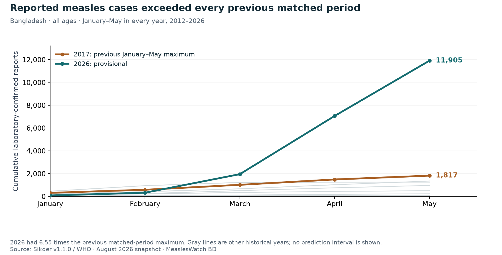
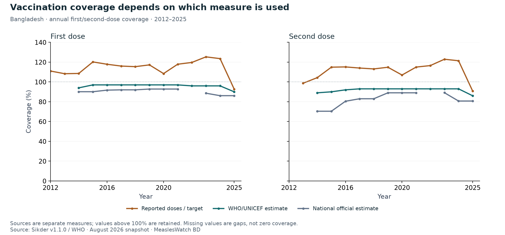
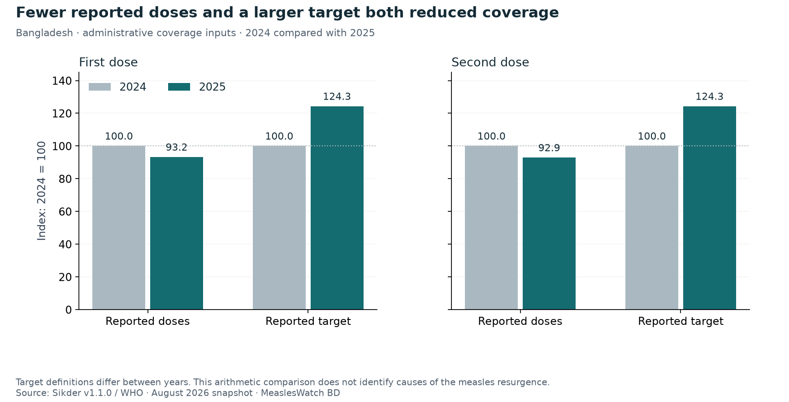
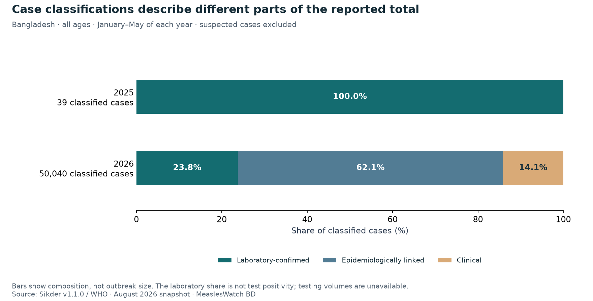

# When high coverage meets a measles resurgence

**Reading Bangladesh's reported cases, vaccination percentages and the numbers behind them.**

Public health data case study · 27 October 2026  
Project contributor: ahmedshahid2929@gmail.com

On 4 April 2026, Bangladesh notified WHO of a nationwide increase in measles. WHO's subsequent alert described reports across 58 of the country's 64 districts. The geographic reach made this a national public health concern. Yet the vaccination data also contained a striking number: first-dose administrative coverage of 123.51% for 2024. How should a reader make sense of a major resurgence alongside a coverage figure above 100%? WHO outbreak alert [1](https://www.who.int/emergencies/disease-outbreak-news/item/2026-DON598)

That question became the starting point for this case study. A percentage alone cannot tell the whole vaccination story, just as a case total alone cannot tell us whether two outbreaks are comparable. I examined three linked questions: how unusual the reported rise was, what changed inside the coverage calculation, and how the definition of a case affected the headline count.

The analysis uses an August 2026 snapshot of WHO-derived records, published by [Pranta Sikder](https://zenodo.org/records/22167512). Monthly surveillance covers all ages, from January 2012 to July 2026; annual vaccination indicators extend through 2025 and refer to their own child target groups. I checked the main calculations against the original CSVs and reconciled 20 vaccination values with separate WHO records. The story below separates those calculations from published outbreak context.

## 1. Reported cases reached 6.6 times the previous January–May high

The first task was to choose a comparison that would survive scrutiny. Comparing five months with a complete year would mix different lengths of observation. Comparing only with a quiet year could make a rise look especially dramatic. I therefore compared January–May 2026 with January–May in every complete year from 2012 to 2025, retaining all 14 historical periods.

The result was clear: **11,905 laboratory-confirmed reports in January–May 2026**, against a previous matched-period maximum of **1,817 in 2017**. Even against that historical high, the 2026 total was **6.55 times as large**. The unusually low 2025 total is therefore unnecessary to make the central finding.

*Read each line as a running total from January. The gray lines retain the other historical years; the highlighted 2017 line is the previous January–May maximum. All 2026 observations are provisional.*

Would the conclusion disappear if the analysis stopped earlier? The January–March laboratory total was 1.60 times its previous matched-period maximum; by January–April, the ratio was 4.76. The broader classified-case series also exceeded its historical maximum at all three endpoints. The size of the increase changes with the window and category, but its direction survives these six checks.

These are comparisons of reported counts, not population infection risks. Testing, reporting and later revisions can affect them. Choosing May limits reliance on the latest, less mature months in the extract; it does not remove reporting bias. The finding is nevertheless useful: within this snapshot, the resurgence remains substantial without a selectively quiet baseline. The next question is what the vaccination indicators can tell us about its context.

## 2. The apparent coverage paradox starts with the measure

Measles makes gaps in protection consequential. WHO explains that two doses are needed because some children do not develop immunity after the first. Its Bangladesh outbreak advice calls for at least 95% coverage with both doses across municipalities. That local emphasis matters: a national average does not reveal which communities have been missed. WHO measles fact sheet [2](https://www.who.int/news-room/fact-sheets/detail/measles); Bangladesh outbreak advice [1](https://www.who.int/emergencies/disease-outbreak-news/item/2026-DON598)

The coverage file contains three different measures. **Administrative coverage** divides reported routine doses by a reported target population. The **national official estimate** is supplied by national authorities. The **WHO/UNICEF estimate**, commonly called WUENIC, is a reviewed estimate drawing on reported information, surveys and context. They answer related questions using related evidence; they are not three independent surveys that can be averaged. WHO indicator definitions [3](https://immunizationdata.who.int/global/wiise-detail-page/measles-vaccination-coverage?CODE=BGD&ANTIGEN=MCV1)

That distinction changes the apparent paradox. The **123.51%** first-dose figure is an administrative ratio, not a finding that more than every child was protected. The WHO/UNICEF first-dose estimate for the same year was **96%**. Values above 100% were retained in this analysis because they are clues about how the reported doses and target fit together, rather than errors to silently cap.

*Follow each source separately. The two panels show first and second doses; administrative ratios above 100% are retained. Disagreement between sources is not a confidence interval.*

This is a recognised measurement problem. In their foundational methods paper, Burton and colleagues explain how incomplete dose reporting, vaccinations outside a target group and inaccurate population estimates can bias administrative coverage. Their account also explains why survey evidence and local knowledge are considered during technical review. It establishes reasons to inspect the inputs; it does not identify which error, if any, occurred in Bangladesh in a particular year. Burton et al., Bulletin of the WHO [4](https://pmc.ncbi.nlm.nih.gov/articles/PMC2704038/)

## 3. Open the fraction: fewer doses, a larger target

Between 2024 and 2025, first-dose administrative coverage fell from **123.51% to 92.66%**. Read alone, that looks like a steep fall in delivery. Opening the calculation shows two simultaneous changes: reported routine doses fell from **4,065,933 to 3,791,393**, while the reported target grew from **3,292,000 to 4,091,813**. That is **6.75% fewer doses** and a **24.30% larger target**.

A smaller numerator lowers the percentage. A larger denominator lowers it too. The source author's decomposition, reproduced here with attribution, shows that both inputs contribute to the change in the ratio. This is an explanation of the calculation; the target increase is not evidence that births or the number of children actually grew by the same amount.

*Both inputs start at 100 in 2024 so their relative changes can be compared. The lines represent reported doses and reported targets, not two estimates of vaccine effectiveness.*

A simple arithmetic illustration makes the denominator's role visible. Divide the 2025 first-dose count by the **old 2024 target**, and the ratio would be **115.17%**. Divide the same doses by the **reported 2025 target**, and it is **92.66%**. The first calculation deliberately holds one input fixed. **It is not corrected coverage or an estimate of how many children were protected.**

The source records give a concrete reason to check comparability: the 2024 target is described as a surviving-infant estimate derived from Bangladesh Bureau of Statistics inputs, while the 2025 target is described as the routine EPI microplan under-one target. The separate WHO API check confirms the recorded inputs and those descriptions. It does not establish that either target is wrong or fully explain why the method changed.

Crucially, the denominator finding does not make the other declines disappear. First-dose delivery reports were lower; second-dose reports were **7.12% lower**. The WHO/UNICEF estimates also moved down, from **96% to 90%** for the first dose and **93% to 86%** for the second. These related indicators deserve attention. Their agreement is not an independent causal test.

The useful interpretation is therefore more precise than 'coverage collapsed' or 'the decline was only a data artifact'. The administrative percentage combines a reduction in reported doses with a change in the reported population base. A programme review needs to examine both, then ask where and among whom vaccination was missed. National annual totals cannot answer that final question.

## 4. Before quoting a case count, ask what was counted

The same discipline applies to measles surveillance. In January–May 2026, the extract contains **50,040 classified reports**. Laboratory-confirmed reports account for **11,905**, or **23.79%**. The remaining classified reports are epidemiologically linked or clinical. Suspected reports are a separate category and are not added to this total.

Both the laboratory series and the broader classified series show a substantial rise in the checked comparisons. They describe different sets of reports, however, so their totals and growth ratios cannot be swapped. In particular, the laboratory share is not test positivity: that calculation would need the number of people or specimens tested, which this monthly extract does not supply.

*The bars compare the composition of classified reports in the same months. The 2025 total is only 39, so a 100% laboratory share has a very small denominator. Bar length shows shares; the labels show totals.*

A separate 2026 investigation by researchers at DGHS and IEDCR helps explain why this distinction matters in practice. The authors note that not every suspected case requires laboratory confirmation and that case-level linkage between specimens and surveillance records was unavailable in their analysis. Their study uses different reporting windows and definitions. It provides context for a measurement question; its totals and age percentages are not merged with our monthly series. Rabbi, Muztahid and Al Mahdi, Emerging Infectious Diseases [5](https://wwwnc.cdc.gov/eid/article/32/11/26-0996_article)

Consequently, a changing laboratory share cannot by itself tell us whether testing became more selective, reporting broadened or the epidemiology changed. Resolving that question requires linked case investigations and testing volumes. It should remain a question in the case study rather than become an unsupported explanation.

## 5. Turn the findings into a better investigation

Taken together, the results lead to three practical lines of enquiry. First, reconcile the vaccination target definitions across years before judging the size of a programme change from percentages alone. Second, examine age- and district-specific coverage and case investigations to find gaps hidden by national totals. Third, link specimens, testing volumes and case classifications so that a rise in reports can be interpreted alongside the surveillance process.

Each question follows from something observed here: an unusually large matched-period total, a visibly changed dose-to-target calculation, and a classified total whose laboratory component is only one part. These are research priorities, not evidence that a particular district or age group caused the outbreak. The WHO report's child-specific statements remain separate contextual evidence; an all-age monthly series cannot locate the risk among children.

There is also a time question. The comparisons use a frozen August extract, viewed retrospectively. Without historical release vintages, this study cannot reconstruct exactly what an analyst would have known in March or April. Earlier endpoints check the stability of a descriptive finding; they do not establish an early-warning system or prospective prediction skill.

The central finding is a substantial reported resurgence that remains visible under fair historical comparisons. The deeper lesson is how to investigate it: keep the calendar, population, denominator and case definition attached to every number. High national coverage figures and a major outbreak can appear in the same evidence record. Understanding that record requires following the numbers back to what was measured, then identifying the local evidence needed next.

## Evidence, sources and contribution

The coverage accounting reproduces analysis already documented by data author Pranta Sikder. This project's contribution is the checked matched-period comparison, endpoint and case-definition checks, direct source reconciliation, reproducible workflow and explanatory synthesis. The analysis is exploratory and retrospective; it does not identify a cause of the outbreak, measure every infection or support clinical decisions.

[Methods and sensitivity table](../portfolio_methods.md) · [Original claim ledger](../../results/portfolio-001/claims.json) · [Additional arithmetic illustration](derived_claims.json) · [Source reading and scope notes](sources.json)

The full primary pages/articles were read. Attributed reading notes and retrieved-text checksums are retained for the new contextual reading; full articles are not redistributed. Context sources were checked on 27 October 2026 and do not update the frozen August observations. The study provides no sampling confidence intervals for administrative aggregates. Reporting completeness and definition changes remain material uncertainties.

## References

1. [World Health Organization. Measles — Bangladesh. Disease Outbreak News. 23 April 2026. DON598.](https://www.who.int/emergencies/disease-outbreak-news/item/2026-DON598)
2. [World Health Organization. Measles. Fact sheet. 15 July 2026.](https://www.who.int/news-room/fact-sheets/detail/measles)
3. [World Health Organization. Measles vaccination coverage. WHO Immunization Data Portal. Accessed 27 October 2026.](https://immunizationdata.who.int/global/wiise-detail-page/measles-vaccination-coverage?CODE=BGD&ANTIGEN=MCV1)
4. [Burton A, Monasch R, Lautenbach B, et al. WHO and UNICEF estimates of national infant immunization coverage: methods and processes. Bulletin of the World Health Organization. 2009;87(7):535–541. doi:10.2471/BLT.08.053819.](https://pmc.ncbi.nlm.nih.gov/articles/PMC2704038/)
5. [Rabbi MF, Muztahid P, Al Mahdi F. Nationwide Surveillance and Control Measures during Large Measles Outbreak, Bangladesh, 2026. Emerging Infectious Diseases. 2026;32(11). Published online 2 October 2026. doi:10.3201/eid3211.260996.](https://wwwnc.cdc.gov/eid/article/32/11/26-0996_article)

**Analytical data:** [Sikder P. WHO-derived Bangladesh measles surveillance and vaccination data. Version 1.1.0. Zenodo.](https://zenodo.org/records/22167512) Frozen August 2026 extract; original coverage decomposition credited to the data author.

**Source reconciliation:** [WHO WIISE administrative coverage records](https://xmart-api-public.who.int/WIISE/AD_COVERAGES), official estimates and WUENIC records; checked 27 October 2026. [Saved queries, responses and 20 comparisons](../../planning/portfolio_sources/wiise-2026-10-27/manifest.json). These checks corroborate the selected coverage inputs, not the monthly surveillance series or a causal interpretation.
