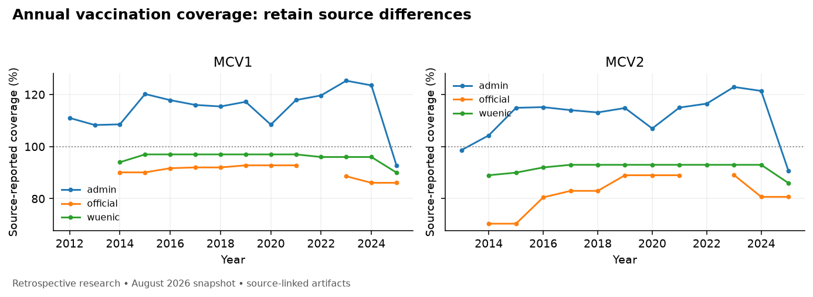
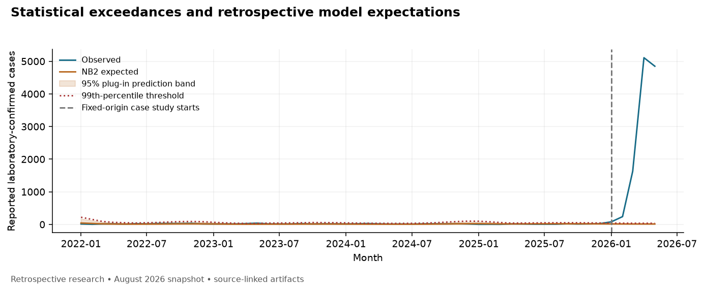

# MeaslesWatch BD: retrospective surveillance and verified scientific communication

**Study snapshot:** August 2026; analysis completed 26 October 2026 (UTC). Research prototype,
not a clinical or operational warning system. This report describes measured results
from frozen public observations and saved Modal outputs.

## Purpose and data

We evaluated whether a compact, reproducible workflow can describe Bangladesh measles
reporting, expose statistical exceedances and produce auditable scientific briefs.
The primary source is [Sikder's version 1.1.0 data package](https://zenodo.org/records/22167512),
DOI 10.5281/zenodo.22167512, containing a secondary WHO surveillance/coverage extract.
The canonical Bangladesh series comprises 175 monthly observations, January 2012–July
2026, represented by 875 category records. Annual coverage has 81 source-specific
records; campaigns have 14 records. Original source bytes, checksums, row locators,
provisional labels and missing-value meanings are preserved. Downloaded author scripts
were not executed; author susceptibility-model outputs are not observed outcomes.

All-age laboratory-confirmed reported cases are the primary outcome. Total classified
cases are a separate sensitivity target. Suspected cases are not added to that total.
The supplementary seven-country explorer quarantines 13 invalid measure cells while
retaining their original strings. A recorded zero remains distinct from an unavailable
report. Administrative coverage above 100% is retained for denominator review, rather
than clipped. Neither source disagreements nor absent sampling variances justify
inventing coverage confidence intervals.

[WHO DON598](https://www.who.int/emergencies/disease-outbreak-news/item/2026-DON598)
provides separate document context. Its laboratory totals conflict between sections,
and age/coverage statements have unresolved inconsistencies. Twelve attributed
statements are retained with conflict labels. These statements never become pediatric
monthly observations or denominators for all-age incidence. This analysis does not
reconcile conflicting document values by choosing a preferred number.

## Statistical methods

The prespecified design uses initial history in 2012–2016, rolling development origins
in 2017–2021 and rolling test origins in 2022–2025. Each 60-month training window ends
before its target observation. January–May 2026 is a distinct fixed-origin case study,
fitted once through December 2025. All 2026 reports are provisional; lag-sensitive
June–July remain descriptive. Historical release vintages are unavailable: ordering
is leakage-free by observation time, not a reconstruction of real-time information.

Comparators are previous-year same-month seasonal naive, a same-calendar-month
historical mean with explicit Poisson-reference bands, and NB2 regression with an
intercept, time and one annual sine/cosine pair. NB2 dispersion is estimated only from
training data. Convergence failures remain unavailable; no silent model substitution
is used. Prediction intervals are plug-in conditional count intervals and omit some
parameter, ascertainment and reporting uncertainty. MAE/RMSE use reported cases;
extremely small conditional tail probabilities can numerically underflow to zero.
MASE scales are training-only. Dispersion, Pearson residuals and residual autocorrelation
are saved. Error uncertainty uses 1,000 paired circular block resamples of 12 months.

Declared sensitivity analyses use 36/84-month NB2 windows, the classified-total outcome,
one doubled training maximum and three deleted training observations in isolated
copies. The incomplete training window is rejected rather than imputed. Forty
synthetic paths span Poisson/NB2 backgrounds, two pulse strengths and ten replicates
per configuration, with separate clean/injected paths and a fixed training period.
Only those artificial labels support detector precision/recall and delay estimates.

## Surveillance and model results

The largest complete-calendar-year laboratory-confirmed count in the historical
2012–2025 window was 4,446 in 2019; September 2019 had 677 reports. WUENIC MCV1 coverage
was 96% in 2024 and 90% in 2025;
MCV2 was 93% and 86%, respectively.
These are descriptive annual changes, not estimates that coverage changes caused
subsequent counts. Administrative, official and WUENIC series remain distinct.

| Laboratory-confirmed test model | Scored/eligible months | MAE | RMSE | 95% interval coverage |
| --- | --- | --- | --- | --- |
| seasonal naive | 48/48 | 8.42 | 11.10 | unavailable |
| seasonal reference | 48/48 | 94.21 | 111.28 | 10.4% |
| negative binomial | 48/48 | 10.00 | 12.33 | 95.8% |

The seasonal-naive comparator had lower point error than NB2. NB2 minus naive MAE was
1.58 cases (block-bootstrap 95% interval
-0.09, 2.85). With only 48
test months, this interval does not establish a precise difference or prospective
skill. NB2's interval coverage was 95.8%, with mean width
47.60 cases and 1 upper-99th-percentile exceedance(s).
The Poisson-reference seasonal detector substantially under-covered, exposing its
stationary-reference/equidispersion assumptions rather than validating its bands.

In the pre-test 2017–2021 training window, NB2 dispersion was
1.19; Pearson dispersion was
1.43, versus
193.22 under Poisson. Substantial residual
autocorrelation remained. NB2 absorbs excess count variation but does not establish
an adequate temporal model; empirical interval coverage alone is insufficient.

All 5 of 5 fixed-origin January–May 2026
laboratory observations exceeded the NB2 upper threshold. This is a retrospective
statistical result; it is not independently labeled outbreak sensitivity or warning
lead time. Changing windows and classifications changes expectations, so the
prespecified primary model is retained rather than selected on test performance.
The 36-month sensitivity failed on 2/48 test months;
the 84-month window had MAE 31.64, emphasizing dependence on history.
Synthetic failures remain visible: low-dispersion Poisson simulations can fail NB2
fitting, reducing scored monthly denominators, while missed-event counts include
undetected/failed events. The original monthly summaries condition on available
predictions, differing from the all-eligible denominator in the protocol. A separate
failure audit retains all 120 clean months and 30 pulse months per configuration.
For NB2 on the twofold Poisson pulse, 36 clean
predictions are unavailable; monthly recall is bounded by
63.3%–93.3%
when unavailable labels remain unidentified. These are identification bounds, not
confidence intervals. Synthetic results do not measure effectiveness in Bangladesh.

Six original figures, plotted CSV data and source/method sidecars are included;
reporting, seasonality, residuals and window sensitivities are available in the dashboard.

## Analyst and independent evaluation

The analyst is hybrid RAG without training: structured retrieval selects hash-checked
statistical artifacts and TF-IDF retrieval selects source passages. A pinned pretrained
Qwen3-4B generates a typed draft on one private Modal L40S. A deterministic checker
then re-queries evidence and validates numerical value, unit, case definition, geography,
population, period and source locator. Verified six-section prose uses checked claims
and limitation templates; arbitrary draft prose is not certified. Empty generations
remain failures. Two saved Bangladesh briefs provide separate end-to-end examples.
Grounding and verification share public-source adapters, so common parsing/scope
errors can survive both. The separate gold/oracle is the independent evaluation boundary.

The independent external-v1 benchmark contains 30 test and six development questions
from CDC, ECDC and UKHSA publications, excluding the Bangladesh dataset and DON598.
Questions, gold, tolerances and sources were frozen before outputs. Runtime source
adapters and the private scoring oracle are separately authored; no external blinded
human adjudication or unknown-to-model facts are claimed. Runtime tests deny private
file access and exercise all public questions successfully.

Condition A receives original source text; B receives identical source coverage plus
calculated facts; C verifies the exact B draft without another model sample. This
isolates computation/verification, not retrieval versus no evidence. Lexical retrieval
quality is measured separately: top-four known-source passage retrieval covers
70.3% of registered slot evidence,
with every registered operand passage retrieved for
60.0% of test questions. These are
passage-overlap proxies, not semantic entailment or open-world retrieval guarantees.
One paired seed produces 60 test generations and 90
scored outputs; additional seeds were deferred by a recorded budget/completion amendment.
Completed development prompts from before a prospective metadata correction remain
archived and are mixed-version, so development scores are not final-system estimates.

The first test attempt stopped after a client disconnection, leaving only five paired
questions answered. Its original failure-inclusive scores across all 30 questions are:

| Original-attempt condition | Strict item accuracy | Numeric slot accuracy | Answer coverage |
| --- | --- | --- | --- |
| A | 0.0% | 19.4% | 16.7% |
| B | 3.3% | 21.0% | 16.7% |
| C | 3.3% | 21.0% | 16.7% |

The completed experiment below is a **secondary infrastructure-recovered analysis**.
Only jobs returning no model response were continued under the same reservation;
all returned drafts, seeds and prompts were retained. This is a documented deviation
from the frozen rule that infrastructure failures remain failures, not a claim that
the original run completed successfully. Both datasets and scorecards are preserved.

| Recovered test condition | Strict item accuracy | Numeric slot accuracy | Fully supported slots | Citation precision | Answer coverage |
| --- | --- | --- | --- | --- | --- |
| A | 0.0% | 88.7% | 6.9% | 44.6% | 96.7% |
| B | 6.7% | 98.4% | 33.7% | 65.5% | 100.0% |
| C | 10.0% | 100.0% | 41.6% | 74.5% | 100.0% |

Strict credit requires every required value, scope, citation, status and limitation.
All failures count; first-pass and post-schema-repair outputs are separately saved.
The displayed values are post-repair. Citation precision is registered-slot passage
overlap, not universal semantic entailment. Whole-item paired bootstrap comparisons:
B_minus_A: 6.7 percentage points (item-bootstrap 95% interval 0.0, 16.7); C_minus_B: 3.3 percentage points (item-bootstrap 95% interval -6.7, 13.3). Intervals describe this selected question bank, not a general model
ranking. Items share four source documents; item resampling does not estimate
between-publication generalization uncertainty. Rule-based causal flags have limited
coverage of subtle free prose.

Across the saved development/test B drafts, the independent scorer identified
84 erroneous emitted registered claims;
the checker detected 20 (23.8%).
It modified/rejected 3 of
34 independently supported claims
(8.8%). These strict denominators include metadata
and citation errors; they do not measure detection of every unstructured hallucination.
Case-level verdicts and a separate reviewed subset expose residual errors.

An AI-conducted inspection of eight prospectively selected cases compared original
passages, gold, A/B/C outputs, scope fields and unverified prose. It is a purposive
case inspection, not blinded external human adjudication or another accuracy estimate.
Exact category strings and registered citation overlap can reject semantically useful
answers; conversely, correct numbers alone do not establish correctly scoped evidence.
The frozen grading was retained. In particular, shared source-adapter errors can
survive C, which is why its own acceptance label is not an independent gold verdict.

| Inspected item | Observed behavior and remaining limitation |
| --- | --- |
| EXT-01 | All conditions give 800 total and 557 laboratory cases, but C retains all_ages on interpretation slots and a nonregistered period citation. A's prose also mistakes 251 sequenced specimens for epidemiologically linked cases. |
| EXT-06 | All conditions calculate 162/210 = 77.14%, retaining 30 unknown-status cases. C repairs citations but substitutes all_ages for three non-Texas count scopes; A adds a mistaken source-conflict explanation. |
| EXT-09 | All conditions identify at least three epidemiologically linked cases and reject three unrelated cases. B/C retain all_ages on logical interpretation fields; A's summary is an unfilled generic phrase. |
| EXT-10 | B/C correctly decline vaccine-effect identification, but retain incorrect interpretation populations and nonregistered citations. A emits string yes/no values; B's prose misleadingly says Texas data are excluded. |
| EXT-15 | All conditions distinguish NRC from zero. A's human-readable marker meaning fails the literal category contract; B/C retain all_ages rather than not_applicable on interpretation fields. |
| EXT-18 | All conditions separate observation year 2024 from retrieval date 2025-03-20. B/C retain a citation mismatch for the year and all_ages on the retrieval-date interpretation slot. |
| EXT-26 | All conditions give 654, 68.27% calculated and 68% reported. C improves count evidence but cites only one age component and an alternative total row; strict registered-locator grading still fails. |
| EXT-30 | A/B identify conflicting dates and equal totals but omit the required single-window boolean. C preserves ambiguity and does not invent that missing claim, yet drops the specific provisional/conflict prose and retains date-field population errors. |

Full notes and unchanged programmatic verdicts are saved in
[the case inspection](../results/benchmark-score-001/answer_review.json).

## Reproducibility, limits and conclusion

The locked Python environment, source manifests, tests, exact prompts, raw/final
responses, verification decisions and failed attempts are retained. A fresh offline
rebuild matches all four canonical, eight descriptive and eight statistical artifact
hashes in the verified environment. Model sampling uses the recorded seed/settings;
GPU/library changes need not reproduce identical text. No paid per-token API or local
LLM inference is used. Modal reservations are conservative estimates, not measured
charges or provider billing caps; the cumulative project authorization is $30.

Surveillance ascertainment, classification changes, provisional data, limited test
length, missing real outbreak labels, plug-in intervals, bounded source adapters,
shared question-authoring context and a small one-seed benchmark constrain conclusions.
The system demonstrates auditable retrospective analysis and constrained scientific
communication. It does not establish causality, clinical applicability, prospective
prediction, universal factual verification or public-health impact.

**Evidence:** [analysis index](../results/analysis_results.json),
[statistical manifest](../results/statistics-001/run_manifest.json),
[inference manifest](../results/research-001/run_manifest.json),
[score manifest](../results/benchmark-score-001/manifest.json),
[source attribution](../DATA_SOURCES.md), [reproduction](../README.md).
